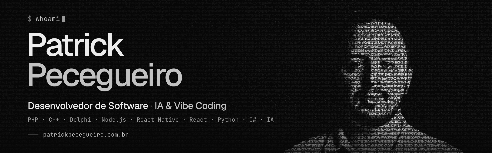

<a href="https://patrickpecegueiro.com.br">
  <picture>
    <source media="(prefers-color-scheme: dark)" srcset="./assets/cover-dark-anim.webp">
    <source media="(prefers-color-scheme: light)" srcset="./assets/cover-light.png">
    
  </picture>
</a>

## `$ whoami`

Sou Patrick Pecegueiro, desenvolvedor de software, e escrevo código desde os 14 anos — comecei no PHP, gerando páginas no servidor e descobrindo que dava para colocar qualquer ideia no ar. Hoje meu foco é inteligência artificial: crio bots e agentes, integro IA em projetos grandes e desenvolvo com vibe coding — modelos de linguagem como parceiros, sem abrir mão da qualidade que só a experiência dá.

```
LOCAL         Campo Grande, MS · remoto, todo o Brasil
ORIGEM        Nova Friburgo · Cordeiro, RJ
CÓDIGO        desde 2003 · primeira linha aos 14, em PHP
JÁ ATUEI EM   RJ ES MG PE MT RO AC MS
STATUS        ● buscando sempre desafios
```

## `~/stack`

**Cada linguagem, um commit.** Começa num PHP escrito aos 14 anos e chega aos bots, agentes e ao vibe coding de hoje — com um branch que saiu da serra fluminense e foi parar em Campo Grande.

```
~/stack (main) $ git log --graph --oneline

* aa465ea (HEAD -> main) feat(vibecoding): o código virou conversa · 2025 · aos 36
*   f153fbd (ms) merge: rj → ms — de Nova Friburgo/Cordeiro para Campo Grande
|\
| * bd7baa8 (rj) feat(rj): raízes na serra fluminense
* | e76c369 feat(ai): bots, agentes e IA em produção · 2024 · aos 35
* | 66c2714 feat(csharp): robustez .NET · 2023 · aos 34
* | 30ef49d feat(python): dados e automação · 2022 · aos 33
* | 329bf89 feat(react): interfaces declarativas · 2022 · aos 33
* | 15a8860 feat(reactnative): apps no bolso · 2021 · aos 32
* | 065650e feat(node): javascript no servidor · 2018 · aos 29
* | ac05b0d feat(delphi): desktop na velocidade do RAD · 2014 · aos 25
* | d51ec98 feat(cpp): a máquina por dentro · 2010 · aos 21
|/
* c218d18 (tag: v0.1-primeira-linha) feat(php): onde tudo começou · 2003 · aos 14

(END)
```

<sub><code>HEAD</code> onde estou hoje &nbsp;·&nbsp; <code>tag</code> a primeira linha de código &nbsp;·&nbsp; <code>rj → ms</code> da serra fluminense para Campo Grande</sub>

## `~/servicos`

**Software sob medida, apps e IA para o seu negócio.** Trabalho de forma remota, a partir de Campo Grande (MS), com empresas de todo o Brasil.

<table>
<tr>
<td colspan="2" valign="top"><code>01 · ia/ · foco atual</code><br><b>IA aplicada ao seu negócio</b><br><sub>Chatbots e atendimento automatizado no WhatsApp, agentes de IA que executam tarefas e integração de modelos de linguagem aos sistemas que a empresa já usa.</sub></td>
</tr>
<tr>
<td width="50%" valign="top"><code>02 · web/</code><br><b>Sistemas web sob medida</b><br><sub>Plataformas, painéis de gestão e APIs com PHP, Node.js e React — do primeiro protótipo ao sistema rodando em produção.</sub></td>
<td width="50%" valign="top"><code>03 · mobile/</code><br><b>Apps para iOS e Android</b><br><sub>Aplicativos com React Native, com uma base de código para as duas plataformas, inclusive apps que funcionam sem internet.</sub></td>
</tr>
<tr>
<td valign="top"><code>04 · automacao/</code><br><b>Automação e integrações</b><br><sub>Fluxos de trabalho automatizados, processos mais ágeis e integrações com as grandes ferramentas do mercado.</sub></td>
<td valign="top"><code>05 · desktop/</code><br><b>Sistemas desktop</b><br><sub>Desenvolvimento e evolução de sistemas desktop em Delphi, C# e C++ — a base de muitos ERPs e operações que não podem parar.</sub></td>
</tr>
<tr>
<td valign="top"><code>06 · vibecoding/</code><br><b>Desenvolvimento acelerado com IA</b><br><sub>Vibe coding com mais de duas décadas de experiência: a IA acelera a execução, e a revisão de quem conhece o ofício garante a qualidade.</sub></td>
<td valign="top"><code>07 · palestras/</code><br><b>Palestras sobre IA</b><br><sub>Palestras que explicam inteligência artificial na prática para empresários e equipes — como “Do Tear à IA”, para a indústria da moda.</sub></td>
</tr>
</table>

## `~/projetos`

**Coisas que ajudei a colocar no mundo.**

`ativos/` &nbsp;envolvimento total

- [**JustJoy**](https://app.justjoy.com.br) — gestão para venda consignada: central na web e app do vendedor que funciona sem internet.
- [**Pangaré Digital**](https://pangaredigital.com.br) — gestão pecuária do curral ao caixa: o peso do boi pelo celular, sem balança.
- **Meu Cuida Mais** — clube de descontos que conecta clientes a empresas parceiras.
- **Bom Fluxo** — produto em que estou envolvido de ponta a ponta. Detalhes em breve.

`participei/` &nbsp;projetos dos quais participei

- [**Prorius Tecnologia**](https://prorius.com.br) — software de gestão de Nova Friburgo (RJ): ERP para confecção, PDV e app para sacoleiros.
- **Prorius Carga** — projeto ligado à Prorius do qual participei.

## `~/palestras`

**Do Tear à IA** — como a inteligência artificial vai costurar o futuro do seu negócio.

> A indústria têxtil puxou as grandes revoluções tecnológicas, do tear ao computador. A IA é a próxima, e ela já cabe no celular do empresário.

<sub>60 min · 36 slides em 7 partes · para empresários e gestores de confecções e indústrias têxteis</sub><br>
<sub>→ [abrir a apresentação](https://patrickpecegueiro.com.br/palestras/do-tear-a-ia) · [ler o material](https://patrickpecegueiro.com.br/palestras/do-tear-a-ia/material) · [todas as palestras](https://patrickpecegueiro.com.br/palestras)</sub>

## `~/contato`

**Vamos construir algo juntos?** Buscando sempre desafios — mande um e-mail, chame no WhatsApp ou no Instagram.

<p>
<a href="https://patrickpecegueiro.com.br"><picture><source media="(prefers-color-scheme: dark)" srcset="https://img.shields.io/badge/patrickpecegueiro.com.br-ededed?style=flat-square&logo=data%3Aimage%2Fsvg%2Bxml%3Bbase64%2CPHN2ZyB4bWxucz0iaHR0cDovL3d3dy53My5vcmcvMjAwMC9zdmciIHZpZXdCb3g9IjAgMCAyNCAyNCI%2BPHBhdGggZD0iTTQgNi41bDYgNS41LTYgNS41IiBmaWxsPSJub25lIiBzdHJva2U9IiMwNzA3MDciIHN0cm9rZS13aWR0aD0iMi40IiBzdHJva2UtbGluZWNhcD0icm91bmQiIHN0cm9rZS1saW5lam9pbj0icm91bmQiLz48cGF0aCBkPSJNMTIuNSAxOGg3LjUiIHN0cm9rZT0iIzA3MDcwNyIgc3Ryb2tlLXdpZHRoPSIyLjQiIHN0cm9rZS1saW5lY2FwPSJyb3VuZCIvPjwvc3ZnPg%3D%3D"></picture></a>
<a href="mailto:me@patrickpecegueiro.com.br"><picture><source media="(prefers-color-scheme: dark)" srcset="https://img.shields.io/badge/me%40patrickpecegueiro.com.br-ededed?style=flat-square&logo=data%3Aimage%2Fsvg%2Bxml%3Bbase64%2CPHN2ZyB4bWxucz0iaHR0cDovL3d3dy53My5vcmcvMjAwMC9zdmciIHZpZXdCb3g9IjAgMCAyNCAyNCI%2BPHJlY3QgeD0iMi41IiB5PSI1IiB3aWR0aD0iMTkiIGhlaWdodD0iMTQiIHJ4PSIyIiBmaWxsPSJub25lIiBzdHJva2U9IiMwNzA3MDciIHN0cm9rZS13aWR0aD0iMi4yIi8%2BPHBhdGggZD0iTTMuNSA2LjVsOC41IDYuNSA4LjUtNi41IiBmaWxsPSJub25lIiBzdHJva2U9IiMwNzA3MDciIHN0cm9rZS13aWR0aD0iMi4yIiBzdHJva2UtbGluZWpvaW49InJvdW5kIi8%2BPC9zdmc%2B"></picture></a>
<a href="https://www.linkedin.com/in/patrickpecegueiro-9158a5153/"><picture><source media="(prefers-color-scheme: dark)" srcset="https://img.shields.io/badge/LinkedIn-ededed?style=flat-square&logo=data%3Aimage%2Fsvg%2Bxml%3Bbase64%2CPHN2ZyB4bWxucz0iaHR0cDovL3d3dy53My5vcmcvMjAwMC9zdmciIHZpZXdCb3g9IjAgMCAyNCAyNCI%2BPHJlY3QgeD0iMiIgeT0iMiIgd2lkdGg9IjIwIiBoZWlnaHQ9IjIwIiByeD0iMy4yIiBmaWxsPSIjMDcwNzA3Ii8%2BPGNpcmNsZSBjeD0iNy40IiBjeT0iNy4zIiByPSIxLjc1IiBmaWxsPSIjZWRlZGVkIi8%2BPHJlY3QgeD0iNS45IiB5PSI5LjciIHdpZHRoPSIzIiBoZWlnaHQ9IjguNiIgZmlsbD0iI2VkZWRlZCIvPjxwYXRoIGQ9Ik0xMC45IDkuN2gyLjg1djEuMjVjLjQ4LS44NiAxLjU1LTEuNDUgMi45LTEuNDUgMi4zNSAwIDMuMzUgMS40NSAzLjM1IDMuOTV2NC44NWgtM3YtNC4zYzAtMS4yNS0uNDItMS45NS0xLjQ1LTEuOTUtMS4xIDAtMS42NS44LTEuNjUgMS45NXY0LjNoLTN6IiBmaWxsPSIjZWRlZGVkIi8%2BPC9zdmc%2B"></picture></a>
<a href="https://www.instagram.com/patrickodev/"><picture><source media="(prefers-color-scheme: dark)" srcset="https://img.shields.io/badge/%40patrickodev-ededed?style=flat-square&logo=instagram&logoColor=070707"></picture></a>
<a href="https://wa.me/5522997549353"><picture><source media="(prefers-color-scheme: dark)" srcset="https://img.shields.io/badge/(22)%2099754--9353-ededed?style=flat-square&logo=whatsapp&logoColor=070707"></picture></a>
<br>
<sub><a href="https://patrickpecegueiro.com.br">patrickpecegueiro.com.br</a> · <a href="mailto:me@patrickpecegueiro.com.br">me@patrickpecegueiro.com.br</a> · <a href="https://www.linkedin.com/in/patrickpecegueiro-9158a5153/">LinkedIn</a> · <a href="https://www.instagram.com/patrickodev/">Instagram @patrickodev</a> · <a href="https://wa.me/5522997549353">WhatsApp (22) 99754-9353</a></sub>
</p>

<sub><code>uptime: desde 2003 · feito com Next.js + JS puro · vibe-coded com IA</code> &nbsp;→&nbsp; <a href="https://patrickpecegueiro.com.br">patrickpecegueiro.com.br</a></sub>
